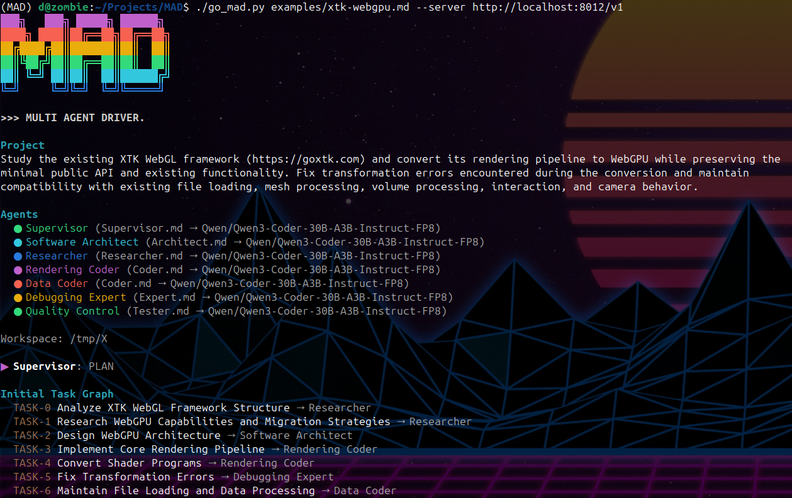

# MAD — Multi Agent Driver

Agents with Markdown-defined roles and skills work together on a project. A Supervisor coordinates tasks and reviews results.

Start an OpenAI-compatible model server (see `mad_server`), then run an example:

```bash
# One coder builds a small solar system application
./go_mad.py examples/solar_simple.md

# Several agents collaborate on the same project
./go_mad.py examples/solar.md
```

Project files define the objective, workspace, success criteria, and agents. Deliverables go in the workspace; audit records go in `.mad/audit` inside it.


