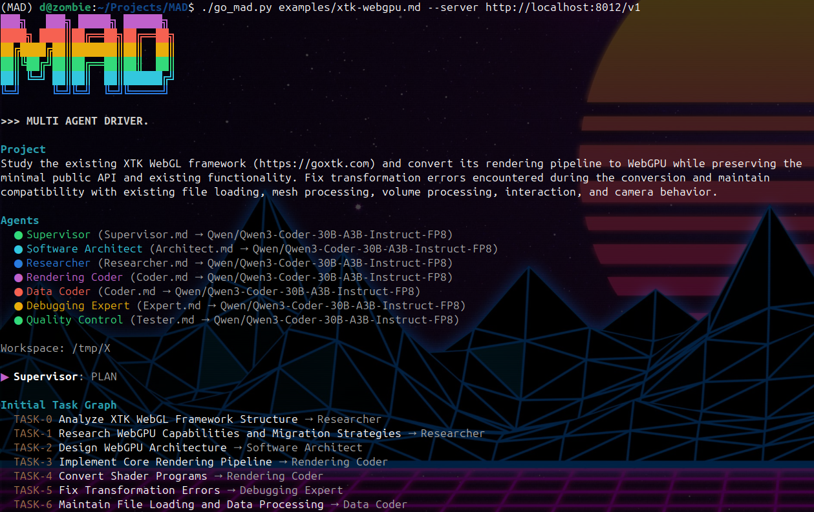

# MAD — Multi Agent Driver

Agents with Markdown-defined roles work together on a project. A Supervisor coordinates tasks and reviews results.

Start an OpenAI-compatible model server (see `mad_server`), then run an example:

```bash
# One coder builds a small solar system application
./go_mad.py examples/solar_simple.md

# Several agents collaborate on the same project
./go_mad.py examples/solar.md
```

Project files define the objective, workspace, optional success criteria, and available roles. The first agent is the Supervisor. It divides the work into Contracts with an owner (the configured worker name), input, task, output files (or inline output), acceptance criteria, and dependencies.

CrewAI runs independent worker tasks in parallel. Every Delivery goes immediately to Quality Control; FAIL feeds corrections back to the worker through CrewAI's guardrail retries. The Supervisor accepts PASS deliveries before dependent work starts and makes the final project decision. Examples without a QC role receive a separate reviewer automatically.

Install the MAD environment with `conda env update -f environment.yml`, or install the new dependency with `python -m pip install crewai==1.15.34`. Shared guidance lives in `mad/instructions.md`. Colored status output uses `mad/ui.py`; readable Markdown logs, JSONL events, and full CrewAI output go in the workspace's `.mad/audit`.

CrewAI tools require vLLM’s `--enable-auto-tool-choice --tool-call-parser qwen3_coder` flags for the example Qwen model. Both launch scripts include them.

Use `--server http://localhost:8012/v1` for another model endpoint, and `--model` or `--workspace` to override project settings.


